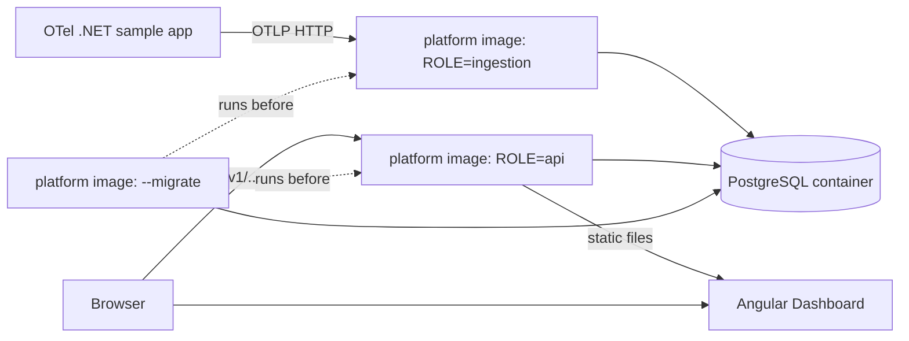

# Requirements

### Overview & Goals
Containerize the certified Doc B MVP backend (`Platform.Api`, `Platform.Ingestion`) and the Angular Dashboard into a single deployable image, provide a local production-like Docker Compose stack (PostgreSQL-backed), validate the PostgreSQL provider for real, prove one full containerized OTLP-to-Dashboard flow, and stand up GitHub Actions CI that builds/tests on PRs and publishes versioned images to GHCR on release. No product behavior changes; Doc C/D/E/F and CLI remain out of scope.

### Scope
**In scope:**
- One multi-role Docker image (`ROLE=api` / `ROLE=ingestion`) hosting `Platform.Api` (which also serves the compiled Angular Dashboard as static files) and `Platform.Ingestion`.
- Runtime-configurable Dashboard API base URL via an entrypoint-generated `config.json` (no rebuild per environment).
- `docker-compose.yml`: postgres + platform-api (with dashboard) + platform-ingestion + a one-shot migration step, using `Storage__Provider=PostgreSql`.
- Real PostgreSQL validation of migrations/persistence/retention/aggregation against the Compose Postgres instance.
- One documented end-to-end containerized acceptance flow: real OTel .NET OTLP sample app -> Ingestion container -> Postgres -> aggregation -> Api -> Dashboard.
- GitHub Actions: PR workflow (build/test/docker build validation, no push) and release/tag workflow (build/test + push to GHCR with semver + SHA tags).
- `.dockerignore`, deployment docs (`docker.md`, `docker-compose.md`, `ghcr.md`).

**Out of scope:** Helm/Kubernetes manifests (only a documented contract for the next phase), MySQL container validation, Doc C/D/E/F, CLI, any git stage/commit/push, any live GHCR push from this session.

### Functional Requirements
- `docker build` produces a working image runnable as `docker run ... -e ROLE=api ...` or `ROLE=ingestion`, with no SDK/toolchain, secrets, or dev keys baked in.
- Dashboard, served by the `api` role, calls the backend using a URL resolved at container start (env var), not compiled at build time.
- `docker compose up` brings up Postgres + migration job + api + ingestion + (dashboard via api) with health-check-gated startup ordering, and data survives a `docker compose restart`.
- CI on PR never pushes images; CI on release/tag pushes `ghcr.io/<owner>/plaxion-platform:<semver>`, `:<sha>`, and (for the stable channel only) `:latest`.

### Non-Functional Requirements
- Non-root container user; only required ports exposed; small final image (runtime-only base, multi-stage build).
- No secrets in image layers, workflow logs, or committed files.
- Reproducible/deterministic builds (locked restore, Release config).

# Technical Design

### Current Implementation
- `Platform.Api/Program.cs` and `Platform.Ingestion/Program.cs` are independent ASP.NET Core hosts (ports 5095/5292 in dev); `Platform.Api` already supports a `--migrate`-only mode via `MigrateCommand`/`RelationalMigrationRunner` (no `EnsureCreated` reliance, per prior deployment-readiness work).
- `Platform.Aggregation`'s `AggregationHostedService`/`RetentionHostedService` are registered as hosted services inside `Platform.Api`, not a separate process — no separate Aggregation image needed.
- Storage provider is fully configuration-driven (`Storage:Provider`, `ConnectionStrings:Platform`) via `PlatformStorageRegistration`; Staging/Production/QA already reject `InMemory`/`Sqlite` and require `PostgreSql`/`MySql`.
- Angular Dashboard (`src/platform-dashboard-web`) currently bakes `apiBaseUrl` into `environment.prod.ts` at build time — this must become runtime-configurable.
- No Dockerfiles, `.dockerignore`, `docker-compose.yml`, or `.github/workflows/*` exist yet in the repo.

### Key Decisions
1. **Single multi-role image** (`platform` image): one image contains both `Platform.Api` and `Platform.Ingestion` published outputs; an entrypoint script picks which app to launch based on `ROLE=api|ingestion`. Reduces image count/build duplication for the `helm install plaxion-platform` goal, at the cost of coupling their release/build (both still deploy as separate containers/pods from the same image).
2. **Dashboard served by `Platform.Api`**: the Angular production build output is copied into the image and served via ASP.NET `StaticFiles`/SPA fallback middleware from the `api` role container — avoids a second nginx image and avoids CORS for the common case.
3. **Runtime API URL via generated `config.json` + entrypoint substitution**: a small `assets/config.json` (`{ "apiBaseUrl": "..." }`) is fetched by the Angular app at bootstrap instead of using the compiled `environment.apiBaseUrl` directly when running in a container; the container entrypoint writes this file from an env var (`API_BASE_URL`, default `""` meaning same-origin) before starting Kestrel. This keeps one image usable across dev/staging/prod without rebuild.
4. **Migration execution**: reuse the existing `dotnet Platform.Api.dll --migrate` one-shot mode as a Compose service (`platform-migrate`) that runs to completion before `platform-api`/`platform-ingestion` start (`depends_on: condition: service_completed_successfully`), matching the documented Production migration policy and directly reusable as a future Kubernetes Job.

### Proposed Changes
- Add a multi-stage `Dockerfile` at repo root: stage 1 (`node`) builds the Angular Dashboard (`npm ci && npm run build -- --configuration=production`); stage 2 (`dotnet/sdk`) restores/publishes `Platform.Api` and `Platform.Ingestion` in Release; stage 3 (`dotnet/aspnet` runtime-only) copies both publish outputs + the Angular `dist` into `wwwroot` under the Api app, creates a non-root user, sets `ENTRYPOINT` to a small shell script (`entrypoint.sh`) that: (a) writes `config.json` from `API_BASE_URL`, (b) execs `dotnet Platform.Api.dll` or `dotnet Platform.Ingestion.dll` based on `ROLE`.
- Wire Angular's `PlatformApiService`/app bootstrap to fetch `assets/config.json` at startup (via an `APP_INITIALIZER`) and fall back to the compiled `environment.apiBaseUrl` when the file is absent/empty (keeps `ng serve`/existing unit tests unaffected).
- Add `.dockerignore` excluding `bin/`, `obj/`, `node_modules/`, `.git/`, docs, test projects.
- Add root `docker-compose.yml`: `postgres` (with named volume + healthcheck), `platform-migrate` (one-shot, `ROLE`/`--migrate`, `depends_on: postgres healthy`), `platform-api` (`ROLE=api`, `depends_on: platform-migrate completed`), `platform-ingestion` (`ROLE=ingestion`, same dependency), all using `Storage__Provider=PostgreSql` and a shared `ConnectionStrings__Platform`; no `.env` file with real secrets committed — use a `.env.example`.
- Add `.github/workflows/ci.yml` (PR trigger: restore/build/test .NET, `npm ci`/`ng test`/`ng build --configuration=production`, `docker build` validation only) and `.github/workflows/release.yml` (tag/release trigger: repeat tests, build image, log in to GHCR with `GITHUB_TOKEN` via `docker/login-action`, tag `ghcr.io/<owner>/plaxion-platform:<semver>` + `:<sha>` + conditionally `:latest`, push via `docker/build-push-action`), using minimal `permissions: contents: read, packages: write`.
- Real PostgreSQL validation: bring up Compose Postgres locally, point existing `Platform.Storage.Relational.Tests`/conformance suite (or a small new integration test) at it via `ConnectionStrings__Platform`, run migrations, and manually verify Tenant/ApiKey/Service/MetricSample/AggregateRollup round-trips plus a restart-durability check; fix any provider-specific defects found.
- Documentation: `docs/deployment/docker.md`, `docker-compose.md`, `ghcr.md` covering topology, build/run commands, required env vars, migration command, tag policy, and a short note on how a future Helm chart consumes this same image/config contract.

### File Structure
- `Dockerfile` (new, repo root)
- `.dockerignore` (new, repo root)
- `docker/entrypoint.sh` (new)
- `docker-compose.yml`, `.env.example` (new, repo root)
- `.github/workflows/ci.yml`, `.github/workflows/release.yml` (new)
- `src/platform-dashboard-web/src/assets/config.json` (new, dev placeholder) + small `AppConfigService`/initializer (new)
- `docs/deployment/docker.md`, `docker-compose.md`, `ghcr.md` (new)

### Architecture Diagram

### Risks
- Angular `APP_INITIALIZER` fetching `config.json` must not break existing unit tests/`ng serve` — mitigated by falling back to compiled `environment.apiBaseUrl` when the file/key is missing.
- Compose `depends_on: service_completed_successfully` requires a modern Compose version; document the minimum version.
- Real PostgreSQL validation may surface provider-specific defects (case sensitivity, timestamp precision) — flagged as a risk to fix within this task's scope, not deferred.

# Testing

### Validation Approach
- `dotnet build` / `dotnet test` (full solution) must stay green after entrypoint/config changes (no production code semantics changed).
- Angular unit tests (`ng test --watch=false --browsers=ChromeHeadless`) must stay green after adding the runtime-config initializer, plus new tests for the fallback behavior.
- Manual/documented container-level validation (build image, run compose stack, curl health/readiness, ingest via a real OTel exporter, view Dashboard) since these aren't covered by existing unit tests.

### Key Scenarios
- `docker build .` succeeds and produces a runtime-only final image (no SDK) under a reasonable size.
- `docker run -e ROLE=api ...` serves both `/v1/*` API routes and the Dashboard static files; `-e ROLE=ingestion` serves `/v1/metrics`.
- `docker compose up` sequence: Postgres healthy -> migration completes -> api & ingestion start -> Dashboard loads and successfully calls the Api using the injected runtime `config.json`.
- Real OTLP flow: sample .NET app with standard OTel exporter -> containerized Ingestion -> Postgres -> aggregation (inside Api) -> Api query endpoints return data -> Dashboard renders it.
- Restart durability: `docker compose down` (keep volume) + `up` again shows previously ingested data still present via the Api/Dashboard.
- CI: a PR run performs build/test/docker-build-validate without pushing; a tag/release run additionally pushes `ghcr.io/<owner>/plaxion-platform:<version>` and `:<sha>`.

### Edge Cases
- Missing/empty `API_BASE_URL` env var -> entrypoint writes an empty/same-origin `config.json`, Dashboard falls back to relative `/v1` calls served by the same `api` container.
- Compose started with a provider other than PostgreSql -> should be actively avoided by the compose file itself (hardcoded `Storage__Provider=PostgreSql`), not left to chance.
- CI workflow triggered by a pull request must never have GHCR push permissions/steps executed (verified by the workflow's `if:` conditions and `permissions:` block).

### Test Changes
- Add Angular unit tests for the new runtime-config fallback (with/without `config.json`).
- Add/extend a PostgreSQL-targeted integration test run (reusing existing `StorageProviderConformanceTests`/relational conformance suite against a real Postgres connection string) to satisfy the "real PostgreSQL validation" requirement; document how to point it at the Compose Postgres instance.

# Delivery Steps

### ✓ Step 1: Add multi-role Dockerfile and runtime Dashboard config
A single `Dockerfile` at repo root builds and packages Platform.Api, Platform.Ingestion, and the Angular Dashboard into one runtime image selectable via ROLE.
- Add a multi-stage `Dockerfile`: Node stage builds the Angular production bundle; .NET SDK stage restores/publishes `Platform.Api` and `Platform.Ingestion` in Release; final ASP.NET runtime-only stage copies both publish outputs plus the Angular `dist` into the Api's `wwwroot`, creates and switches to a non-root user, and sets `ENTRYPOINT` to `docker/entrypoint.sh`.
- Write `docker/entrypoint.sh` to generate `assets/config.json` from an `API_BASE_URL` env var and then exec `dotnet Platform.Api.dll` or `dotnet Platform.Ingestion.dll` based on `ROLE`.
- Add `AppConfigService`/`APP_INITIALIZER` in the Angular app that fetches `assets/config.json` at bootstrap and falls back to the existing compiled `environment.apiBaseUrl` when absent; wire `PlatformApiService` to use the resolved base URL.
- Add `.dockerignore` excluding build artifacts, `node_modules`, `.git`, tests, and docs.
- Add Angular unit tests for the config fallback behavior; verify `dotnet build`/`dotnet test` and `ng test` stay green.

### ✓ Step 2: Create Docker Compose stack with PostgreSQL and migration flow
`docker compose up` starts a working, PostgreSQL-backed Platform stack (migration -> api -> ingestion -> dashboard) using only the existing production configuration model.
- Add root `docker-compose.yml` with services: `postgres` (named volume, healthcheck), `platform-migrate` (one-shot `ROLE=api` running `dotnet Platform.Api.dll --migrate`, depends on postgres healthy), `platform-api` (ROLE=api, depends on migrate completing successfully), `platform-ingestion` (ROLE=ingestion, same dependency).
- Configure all services via `Storage__Provider=PostgreSql`, `ConnectionStrings__Platform`, and `ASPNETCORE_ENVIRONMENT`, using a committed `.env.example` (no real secrets).
- Verify the stack end-to-end locally: containers become healthy, migration applies schema, api/ingestion serve traffic, and data survives a `docker compose down`/`up` cycle against the named Postgres volume.

### ✓ Step 3: Validate the PostgreSQL provider against a real database
The existing PostgreSQL storage provider is proven correct against a real PostgreSQL server started via the new Compose stack, with any provider-specific defects fixed.
- Point the existing relational conformance/integration test suite (or a small targeted test) at the Compose Postgres instance's connection string.
- Exercise migrations, Tenant/ApiKey/Service persistence, MetricSample writes, AggregateRollup writes/queries, and retention behavior against real Postgres.
- Verify restart durability (data persists across container restarts) and that Platform.Api reads data written by a real Platform.Ingestion instance.
- Fix any PostgreSQL-provider-specific defects uncovered; do not extend this validation to MySQL.

### ✓ Step 4: Run and document the full containerized OTLP acceptance flow
A documented, reproducible sequence proves real OTel telemetry flowing end-to-end through the containerized stack into the Dashboard.
- Configure a real OTel .NET sample application (standard OTLP HTTP exporter, not custom Platform JSON ingestion) to send telemetry to the containerized `platform-ingestion` service from the Compose stack.
- Verify data flows through Postgres, aggregation (inside `platform-api`), and is queryable via the Api, then confirm it renders correctly in the Dashboard served by `platform-api`.
- Write the exact commands (compose up, sample app run, curl/dashboard verification) into `docs/deployment/docker-compose.md`.

### ✓ Step 5: Add GitHub Actions CI/release workflows and GHCR publishing
Pull requests run full build/test/docker-validation without pushing; tagged releases build and push versioned images to GHCR.
- Add `.github/workflows/ci.yml`: on pull_request, restore/build/test the .NET solution, `npm ci`/`ng test`/`ng build --configuration=production` for the Dashboard, and a `docker build` validation step with no push.
- Add `.github/workflows/release.yml`: on tag/release, repeat the required tests, build the image, authenticate to GHCR using `GITHUB_TOKEN` via `docker/login-action`, and push `ghcr.io/<owner>/plaxion-platform:<semver>`, `:<sha>`, and conditionally `:latest` for the stable channel, using least-required `permissions` (`contents: read`, `packages: write`).
- Ensure workflows never log secrets and never run push steps on pull_request events.

### ✓ Step 6: Write deployment documentation for Docker, Compose, and GHCR
Deployment docs fully describe the new containerization and publishing model for maintainers and the future Helm phase.
- Add `docs/deployment/docker.md` covering image topology, ROLE-based entrypoint, build/run commands, required env vars, and non-root/security notes.
- Add `docs/deployment/docker-compose.md` covering the local Postgres-backed stack, migration flow, and the containerized OTLP acceptance steps from the prior stage.
- Add `docs/deployment/ghcr.md` covering image naming/tag policy (semver, SHA, latest-for-stable-only), the CI/release workflow behavior, and how a future Helm chart is expected to consume this image and its configuration contract.
- Leave all changes unstaged; do not git add/commit/push per instructions.