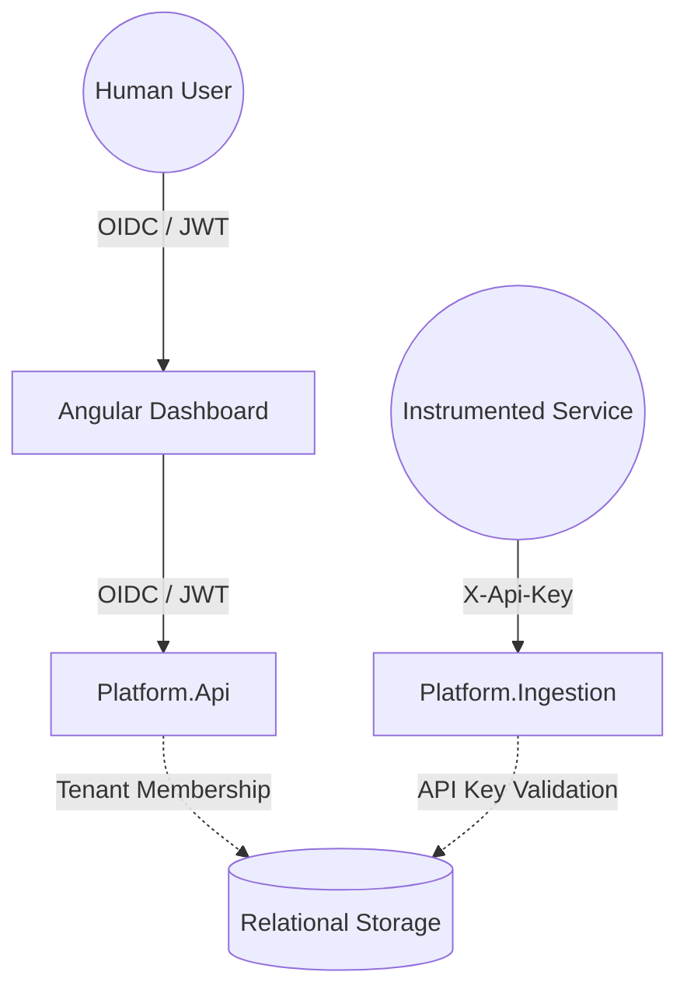

# Authentication and Authorization

PlaxionMediator.Platform implements a dual authentication model designed to separate human/interactive traffic from machine-to-machine telemetry ingestion.

## Architecture Overview

There are two distinct authentication domains in the platform:

1.  **Human/Interactive (OIDC):** Used by the **Dashboard** and **Platform.Api** for tenant management, service browsing, and metric visualization. Authenticated via standard OpenID Connect (OIDC) JWT Bearer tokens.
2.  **Machine/Telemetry (API Key):** Used by **Platform.Ingestion** for receiving OTLP or JSON metrics from instrumented services. Authenticated via high-performance `X-Api-Key` headers.



- **Platform.Api** supports both schemes: API keys for programmatic tenant management and JWT Bearer for the Dashboard.
- **Platform.Ingestion** *only* supports API keys. It is unaffected by OIDC configuration.

---

## OIDC Configuration (Platform.Api)

Authentication for human users is configured via the `Authentication` section in `appsettings.json` or environment variables.

### Configuration Keys

| Key | Required | Default | Notes |
|-----|----------|---------|-------|
| `Authentication:Enabled` | No | `false` | When `true`, JWT Bearer validation is active. |
| `Authentication:Authority` | Yes* | `null` | Base URL of the OIDC provider (e.g., Keycloak, Auth0). |
| `Authentication:Audience` | Yes* | `null` | The `aud` claim expected in the JWT (API Resource ID). |
| `Authentication:RequireHttpsMetadata` | No | `true` | Must be `true` in production. Set `false` only for local dev IdPs. |
| `Authentication:AllowAnonymousProduction` | No | `false` | Fail-fast knob. See [Production Safety](#production-safety). |

*\*Required only when `Enabled` is `true`.*

### Example JSON
```json
{
  "Authentication": {
    "Enabled": true,
    "Authority": "https://sso.example.com/realms/plaxion",
    "Audience": "plaxion-platform-api",
    "RequireHttpsMetadata": true
  }
}
```

### Production Safety
To prevent accidental exposure, if `ASPNETCORE_ENVIRONMENT` is `Production` and `Authentication:Enabled` is `false`, the API will **fail to start** unless `Authentication:AllowAnonymousProduction` is explicitly set to `true`.

---

## Dashboard OIDC Client

The Angular Dashboard is a public OIDC client using the **Authorization Code flow with PKCE**. It does not use (and must never be provided with) a client secret.

### Configuration (`Dashboard:Oidc`)

| Key | Default | Notes |
|-----|---------|-------|
| `Dashboard:Oidc:ClientId` | `null` | Public client ID registered at the IdP. |
| `Dashboard:Oidc:Scopes` | `["openid", "profile", "email"]` | Standard OIDC scopes. |
| `Dashboard:Oidc:RedirectPath` | `/auth/callback` | Path within the SPA for the login callback. |
| `Dashboard:Oidc:PostLogoutRedirectPath` | `/` | Path to return to after logging out. |

### Runtime Adaptation
The Dashboard container adapts to different environments without a rebuild. It fetches its configuration from `GET /v1/platform/config` at startup. The `docker/entrypoint.sh` script generates a static `assets/config.json` file from environment variables as a fallback.

---

## Authorization Policies

Plaxion uses named policies to gate access based on the authentication scheme and claims.

### 1. Tenant Creation (`TenantCreation`)
Controls who can call `POST /v1/tenants` to provision new tenants.
- **Config:** `Authorization:TenantCreation`
- **Modes:**
    - `AnyAuthenticatedUser` (Default): Any valid JWT holder.
    - `Role`: Requires a specific role in the `role` or `roles` claim.
    - `Claim`: Requires a specific claim type and (optionally) specific values.

### 2. Tenant Membership (`TenantMember`)
Ensures a user only accesses tenants they belong to.
- **Behavior:** Checks the `ITenantMembershipStore` for a row matching the JWT's `iss` (issuer) and `sub` (subject) for the requested `tenantId`.
- **Security:** Failures return **404 Not Found** instead of 403 Forbidden to prevent leaking the existence of tenant IDs.

### 3. Platform Administrator (`PlatformAdministrator`)
A "break-glass" or operator policy used for cross-tenant operations and legacy upgrades.
- **Config:** `Authorization:PlatformAdministrator`
- **Modes:** `Disabled` (Default), `Role`, or `Claim`.
- **Bypass:** Principals satisfying this policy bypass `TenantMember` checks.

---

## Tenant Membership Model

Access to specific tenants is managed via membership records in the platform storage.

| Field | Description |
|-------|-------------|
| `IdentityIssuer` (`iss`) | The OIDC issuer that authenticated the user. |
| `IdentitySubject` (`sub`) | The unique identifier for the user within that issuer. |
| `TenantId` | The GUID of the tenant. |
| `Role` | `Owner` or `Member`. |

### Scoped Authorization
When a user attempts to access a resource under `/v1/tenants/{tenantId}/...`, the platform:
1.  Extracts the `iss` and `sub` claims from the JWT.
2.  Looks for a matching membership record for that `tenantId`.
3.  If no record is found, it returns **404 Not Found**. This applies to all tenant-scoped endpoints, including `/v1/tenants/{tenantId}/services` and `/v1/tenants/{tenantId}/metrics`.

---

## Upgrade Procedure (Legacy Tenants)

Existing tenants created before OIDC was enabled have no membership records. To grant access to OIDC users:

1.  **Enable OIDC:** Configure `Authentication` and `Dashboard:Oidc`.
2.  **Enable Admin Bypass:** Set `Authorization:PlatformAdministrator:Mode` to `Role` (or `Claim`) and assign it to your operator identity.
3.  **Reconcile Membership:** Call the reconciliation endpoint for each legacy tenant:
    ```http
    POST /v1/tenants/{tenantId}/memberships
    Authorization: Bearer <your-admin-token>
    Content-Type: application/json

    {
      "identityIssuer": "https://sso.example.com/realms/plaxion",
      "identitySubject": "user-uuid-here",
      "role": "Owner"
    }
    ```
4.  **Restore Lockdown:** Set `Authorization:PlatformAdministrator:Mode` back to `Disabled`.

---

## Provider Examples

### Keycloak
- **Client Type:** OpenID Connect, Public (no secret).
- **Valid Redirect URIs:** `https://dashboard.example.com/auth/callback`
- **Web Origins:** `https://dashboard.example.com`
- **Config:**
    - `Authority`: `https://keycloak.example.com/realms/myrealm`
    - `Audience`: `account` (or your custom client ID)
    - `ClientId`: `plaxion-dashboard`

### Duende IdentityServer
- **Grant Types:** `GrantTypes.Code`
- **RequirePkce:** `true`
- **AllowOfflineAccess:** `true` (for refresh tokens)
- **Config:**
    - `Authority`: `https://idsrv.example.com`
    - `Audience`: `plaxion-api`
    - `ClientId`: `plaxion-spa`

---

> [!NOTE]
> This documentation covers the **Doc A/B MVP** scope for authentication and authorization. Advanced features such as multi-region identity reconciliation, delegated user management (Doc C+), and CLI-based OIDC login are currently out of scope.
